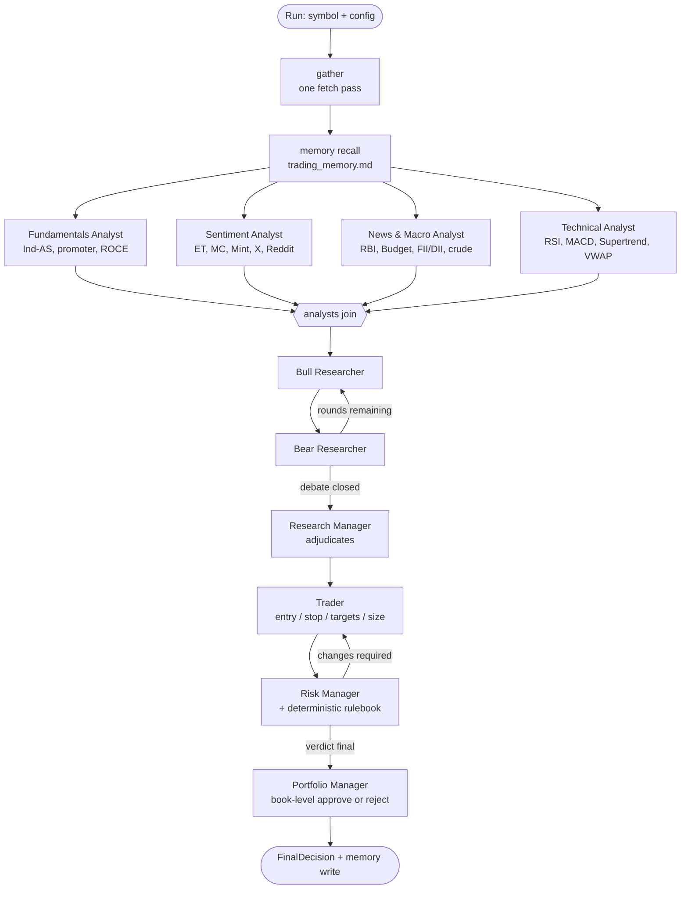

# Architecture

## The graph



The four analysts fan out because they share no state and each is network-bound.
Everything after the join is sequential: each stage genuinely depends on the
last. The debate and the risk review are real cycles in the graph, so
`max_debate_rounds` and `max_risk_rounds` are runtime knobs rather than a graph
rebuild.

## Layers

```
tradingagents_in/
├── config/          DEFAULT_CONFIG, .env overlay, the NSE/BSE universe
├── models/          Pydantic contracts — every agent output is typed
├── dataflows/       Data acquisition. Agents never call a source directly.
├── llm/             Provider factory + structured-output calling with retries
├── agents/          The eight agents and the briefings they read
├── risk/            Deterministic engine: costs, sizing, the rulebook
├── graph/           LangGraph assembly, sequential fallback, reporting
├── memory/          trading_memory.md — the decision log and its recall
└── cli/             The `ita` command
```

## Five decisions worth explaining

### 1. One fetch pass, shared by every agent

`Toolkit.gather()` runs once per run and produces a `MarketBundle`. Every agent
reads from it. This is not only about rate limits: the bull and the bear must
argue over *identical* numbers, or the debate measures data skew rather than
reasoning. The bundle also records which sources succeeded and which failed, and
that record drives a confidence haircut through `DataQuality.completeness`.

### 2. Every agent computes a deterministic draft before the LLM sees anything

`Agent.run()` calls `deterministic_draft()` first, then passes that draft to the
model as a factual anchor. Three consequences:

- **The framework runs with no LLM at all.** `ITA_LLM_PROVIDER=offline` produces
  a complete, sized, risk-checked decision. That is what the test suite asserts
  against, and it is a legitimate way to run the system.
- **Provider failure degrades instead of crashing.** A rate limit, a timeout or
  a schema violation falls back to the draft, and the run is marked accordingly.
- **Numbers stay honest.** The model is asked to *improve* a computed baseline,
  not to invent figures. A hallucinated P/E has to survive contradicting the
  anchor it was handed.

The draft is deliberately not a stub. If it were, the offline path would be
theatre.

### 3. The rulebook outranks the language model

`tradingagents_in/risk/rules.py` is pure Python evaluated against data. The risk
manager agent may *explain* a breach and may be more conservative than the
rulebook says. It cannot overturn a `BLOCKER` — `enforce_rulebook()` clamps the
model's answer back inside the rules after it has spoken, and
`enforce_ceiling()` does the same to the portfolio manager.

The asymmetry is the point. A language model should not be the last thing
standing between a book and a position it cannot exit.

### 4. Size is an output of the stop, never an input

`risk/sizing.py` derives quantity from the stop distance and the risk budget. A
wider stop produces a smaller position; the risk stays fixed. Two India-specific
complications are handled explicitly rather than rounded away:

- **Lot indivisibility.** If one Bank Nifty lot risks more than the entire
  budget, the answer is zero lots. The sizer says so and explains why, instead of
  quietly over-risking.
- **Margin is not notional.** A futures position deploys margin but carries
  notional exposure. Concentration is measured on exposure, affordability on
  margin. Conflating them blocks affordable trades and understates real risk.

### 5. Tradability gates the thesis

A correct directional view on a scrip that is circuit-locked, in the F&O ban
list, under GSM, or too thin to exit is not a tradable idea. The research
manager checks this *before* committing to a stance, and says so plainly rather
than passing the problem downstream. The trader checks it again, and the
rulebook checks it a third time. Redundant on purpose: this is the failure mode
that turns a paper loss into a real one.

## State

`TradingState` is a `TypedDict` because LangGraph merges partial dict updates
from nodes. The *values* are Pydantic models, so each node still receives a
validated contract. `errors` and `telemetry` carry reducers so parallel analyst
nodes can each contribute without clobbering one another.

The `MarketBundle` lives in state under `market_bundle` as an opaque object. It
holds pandas DataFrames, so it is not JSON-serialisable: with checkpointing
enabled, a resumed run re-gathers data rather than restoring the frames.

## Failure handling

Nodes never raise. `_timed()` catches whatever a node throws, records it in
`state["errors"]`, and lets the run continue. A decision produced with one
analyst missing is reported as such — completeness drops, confidence drops, and
the failed source is named in the report's audit section. That is more useful
than a traceback, and more honest than pretending the leg ran.

## Testing

The whole suite runs against `data_provider="synthetic"` with
`llm_provider="offline"` and a fixed seed. No network, no API key, deterministic
output. The synthetic tape is a seeded geometric random walk with realistic
intrabar structure — it exists so tests assert on *agent behaviour*, and it is
explicitly not a market simulator. Nothing about a strategy can be validated
against a random walk, and the module says so.
